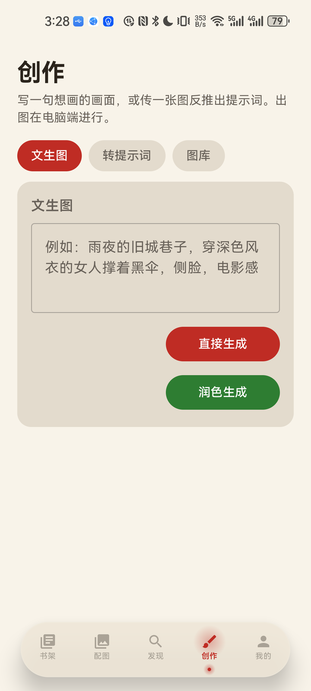
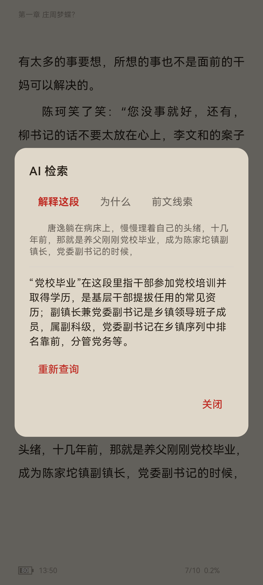

# 长篇小说 AI 能力方案：把「边读边问」和「边读边看」接进阅读器

> 面向两类读者：**已有阅读器的产品/技术团队**（起点读书、QQ阅读这类平台），以及**想自己写阅读器的人**。
> 本文只讲方案、实测数据和踩过的坑，不含任何客户端源码。


**一句话**：397 万字的书，AI 也记得住前文、答得准、不剧透；顺手还能把「这一段」画出来。

---

## 1. 为什么现有阅读器需要这个

长篇连载的读者有三个痛点，目前市面上的主流阅读器基本都只解决了「读」，没解决「读懂」：

1. **看不太懂**：官场、军事、年代文里的人情与体制语境，读者要反复回翻。
2. **记不住**：几百万字之后，某个人物/物件第一次出现在哪、上次提到是什么时候，读者自己查不动。
3. **不敢查**：手机上搜一下，很容易搜到后文的剧透。

而「把整本书塞给大模型」这条路是走不通的：

《重生之官道2026》实测 3,974,713 字符，折算约 **2.9M token**，是 256k 上下文窗口的 **11 倍**；换成 1M 窗口也不够一本千万字的书。

**结论：必须离线建索引，在线只取「读者当前位置之前」的一小段材料。**

---

## 2. 这套方案对已有阅读器的启发

以起点读书、QQ阅读这类成熟产品为例（以下只按公开可见的产品形态判断，未做产品内测）：

| 平台已经有 | 缺的那一块 | 接这套方案后多出来 |
|---|---|---|
| 段评、本章说、章评 | 评论是「人写的」，读者自己的疑问没人答 | **选中一段就问**：解释、为什么、前文线索三档 |
| 角色卡、角色榜 | 角色信息靠作者维护，缺图、易断更 | **一句描述出定妆图**，同角色多版本可切换 |
| AI 朗读、听书 | 只把文字念出来 | 听的时候也能「问这一段在讲什么」 |
| 搜索（书内/书城） | 搜得到，但**不区分前后文**，一搜就剧透 | 检索**硬截断在当前章之前**，物理上不含后文 |

三点具体启发：

1. **AI 不该是「一个对话框」，而是三个不同的问法**。同一段话，问「这是什么意思」「为什么会这样」「这些人前文在哪出现过」，读者要的是完全不同的东西；一次性倒 2000 字没人看。
2. **AI 生图的价值不在「生成」，在「归属」**。图必须挂在具体的那一段、那个角色上，才能被回看、被复用；孤立的图库没人回访。
3. **能力可以外挂，不必进主工程**。下面这套服务是独立进程，阅读器只需要加三个很薄的调用点。

---

## 3. 对接需要做什么（阅读器侧只有三处）

```
阅读器（起点/QQ阅读/自研 App）
    │ ①读到哪：当前位置前 200 字 + 问题
    ▼
云服务器（只做密文转发，不解密、不存书）
    │ ②mTLS 双向证书
    ▼
家里/机房里的一台普通 PC（24 小时开机）
    ├─ 本地索引库（章摘要 + 实体时间线，SQLite，60 MB 级）
    ├─ 检索：先定位读者位置 → 只取该位置之前的材料
    └─ 调大模型出答案；出图时写词调模型、画图用本机显卡
```

阅读器侧只需三个调用点：

| 调用点 | 传什么 | 拿回什么 |
|---|---|---|
| 选中文字 → 问 | 选中文本 + **当前位置前 200 字** + 问题类型（解释/为什么/前文线索） | 一段回答（或「前文没有提到」） |
| 段末 → 配图 | 该段原文 + 可选角色名 | 任务号（立刻返回，之后轮询/推送） |
| 进书 → 认书 | 书名 + 作者 + 文件前 64KB | 是否已有索引、相似度 |

**关键设计**：阅读器不需要改自己的正文结构、不需要上传整本书、不需要把用户数据交出去。索引与画图都在自己这台机器上。

---

## 4. 三条可直接抄的结论（给自研阅读器的人）

这三条是踩坑之后才定下来的，抄走能省很多时间：

1. **章号不能当主键**。同一本书的连载版/精校版/合并版章号会错位；实测某版本按章号去另一版本取材料，**越界 693 章 = 全书 92.2%**。改成用「当前位置前 200 字」在索引里唯一定位。
2. **防剧透必须在 SQL 层硬截断**（`ch_global < 当前章`），不能只靠提示词写「不要剧透」——提示词是第三道保险，不是防线。
3. **认书用 MinHash/KMV 4096 个最小 9-gram**：≥0.90 同书、0.60~0.90 待确认、<0.60 不同书。实测同书异版 **0.9956**、两本不相干的书 **0.0000**。

另外两条经验：

- **解释粒度不要问用户**（不做读者画像问卷）：唯一直接对照实验（PLAI, MuC 2026）显示画像组与无画像组无显著差异。正确做法是条数预算 + 白名单过滤，再做「这本我熟」开关。
- **「为什么」必须给整章**：实测只给上一章末 1000 字，答案「材料不足」的比例 **5→5 完全没降**；给了整章才降到 0。

---

## 5. 实测数据（这套方案跑在真书上）

| 指标 | 数值 |
|---|---|
| 索引成本 | 889 条章摘要 + 89 条聚合，978 次调用，**约 5.4 元/本**，5 并发 25~30 分钟 |
| 单次问答 | **约 0.011 元**（解释这段）~ **0.03 元**（前文线索），6.9 秒 |
| 通道延迟 | 云端 mTLS 转发 `GET /api/ask` → **127 ms** |
| 稳定性 | 服务进程被杀 → 看门狗 **45~70 秒**自动拉起；断网只记一行日志，界面无弹窗 |
| 生图 | 720×1280/标准 40 步 **约 43 秒**；快速 30 步约 34 秒；4K 分钟级 |

---

## 6. 顺带能做的「边读边看」：AI 生图

同一套通道，阅读器多一个「提交任务」的调用点：

- **段评配图**：选中一段 → 出图 → 挂在该段上，读者点「前往」跳回原段。
- **角色一致性**：同一角色有定妆多版本，配图时取参考，人物不换脸；出场画面可改归属、可单张删。
- **一句话创作**：读者自己写一句画面描述就能出图；反过来也能拿一张图反推出可编辑的提示词。




**为什么把画图放在自己机器上**：显卡与权重不出门、成品图不回传第三方、不用养常驻 GPU 实例、与检索共用一条通道。代价是一张图 40 秒到几分钟，所以设计成「提交即返回、可连提多张、显示（1/3）排队进度」。



---

## 7. 三档解释长什么样

| 档位 | 给什么 |
|---|---|
| 解释这段 | 这段在讲什么、人物关系，200~300 字，最多 3 条 |
| 为什么 | 一句因果 + 来龙去脉 + 依据（本段／本章前面） |
| 前文线索 | 这段里的人/物，前文首次出现与最近提及，可点回原章 |

设计原则：默认少给、不替任何一方辩护（原文写到违规就说什么性质，不加「个别现象」这类平衡话）、不做读者画像、两模型共用一份提示词。

---

## 8. 接进来要花多少

一页账，详细拆解见 [`docs/01-技术方案.md` 第 8 章](docs/01-技术方案.md)。

| 项目 | 量级 |
|---|---|
| 客户端改造 | **3~4 人日**（唯一必须进阅读内核的是「当前位置 → 前 200 字」） |
| 服务端 | 外挂 ≈0；私有化 2~3 人日 |
| 机器 | 索引机 8 核 16G，既有 PC 为 0、云上 300~600 元/月；生图需要一张 4090 级显卡 |
| 建索引 | **5.44 元/本**（一次性，只给「被问到的书」建） |
| 每次问答 | 解释 **0.011 元**、前文线索 0.03 元 |
| 每张图 | 本机显卡约 **0.01 元**（电费）；云上 API 0.1~0.3 元 |

---

## 9. 仓库内容

- [`docs/01-技术方案.md`](docs/01-技术方案.md)：结构、三项核心能力、生图链路、实测数据、**接入成本**、交付边界
- [`docs/02-演示脚本.md`](docs/02-演示脚本.md)：给平台方看的 10 分钟演示
- [`docs/03-技术问答.md`](docs/03-技术问答.md)：会被问到的 11 个问题（含「和平台已有 AI 什么关系」「接入要改客户端吗」）

```bash
git clone https://github.com/yjnmedia/ai-reading-assistant.git
cat docs/02-演示脚本.md
```

## 边界

- 本仓库只放方案与实测数据，**不含阅读器客户端源码与安装包**；演示用的客户端基于开源阅读器改造，不对外分发。
- 索引与画图都需要一台长期开机的普通 PC（8 核/16G、有显卡更好），不是云端服务。
- 文中数字均来自真实运行日志与账单。
