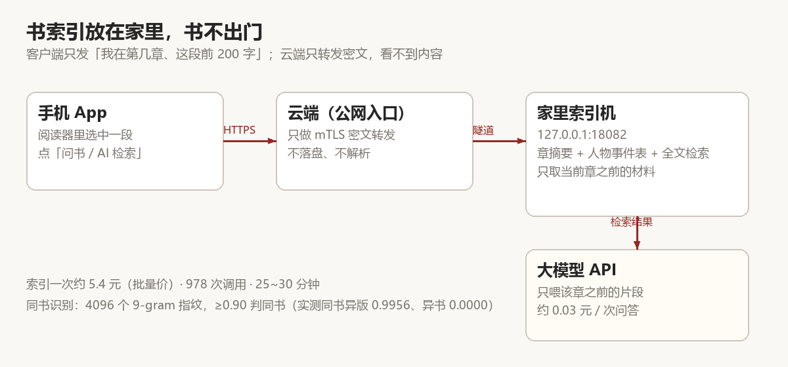

# 长篇小说 AI 阅读助手（方案说明）



**给读长篇网文的人：397 万字的书，AI 也记得住前文、答得准、不剧透；想看图，一句话就能画。**


```bash
git clone https://github.com/yjnmedia/ai-reading-assistant.git
cd ai-reading-assistant && cat docs/02-演示脚本.md
```

## 它解决什么问题

长篇小说动辄百万字，主流大模型一次读不完：一本 397 万字的书约 290 万 token，是 256k 上下文窗口的 **11 倍**，换成 100 万 token 的模型也不够。所以这类需求不能靠「把书塞进去」，只能**先在本地把书拆开、建索引，再按问题取片段**。

## 三种答案，一句话起步


<sub>上图是同一句话的两种问法（真实运行截图，左右并排）：左边「解释这段」只解释这句里的「党校毕业」「副镇长」「党委副书记」；右边「为什么」回答「为什么他会这样想」，并给出依据——都只依据本章前文，不引用后文。</sub>

选中一段话，默认只给一段解释；不够再点开另外两页：

| 你要的 | 它给什么 | 边界 |
|---|---|---|
| 解释这段 | 这段在讲什么：身份职务、制度规矩、行业惯例、人情关系，最多 3 条、350 字内 | 不复述原文、不做文学评论、一目了然的常识不讲 |
| 为什么 | 这段为什么成立：一句因果 + 来龙去脉 + 依据（本段／本章前面），取「上一章全文 + 本章前文」 | 只用到当前位置之前的内容，不碰后文 |
| 前文线索 | 人名/物件首次出现与最近提及，可点回原章 | 只查当前章之前，不判断「是不是伏笔」 |

## 想看图：一句话出图，或拿一张图反推提示词


「创作」页分三栏，都是**对着自己家那台电脑**干活，不是租来的云端画师：

- **文生图**：写一句中文画面（「雨夜的旧城巷子，穿深色风衣的女人撑着黑伞，侧脸，电影感」），两个按钮——
  - 「直接生成」：这句原样交给写词模型；
  - 「润色生成」：先由服务端把中文描述细化成完整提示词（主体、服饰、姿态、环境、光线五段），还能补一句修改意见（「换成夜景」「不要笑」「改成正面」），再出图。
- **图片转提示词**：相册选一张图，多模态模型把它描述成**能直接出图的中文提示词**，写进输入框，你可以改完直接生成——等于把「别人画得好的那张」变成自己的可复用描述。
- **图库**：画过的都留着（本地保存图片与提示词），长按可以**复制提示词、填回文生图、存进相册、删掉**；同一句话想改一版，不用重打。

提交后立刻返回，不用盯着转圈——**可以连着提多张**，底部显示「正在生成（1/3）」这样的排队进度，画完自动落进图库。


尺寸与画质按需选：短边 480p / 720p / 1080p / 1440p / **4K（2160p）**；画质 快速 30 步 / 标准 40 步 / 质量 50 步。默认 720p + 标准，一张约 **43 秒**；4K 要几分钟，适合画完就存相册的封面级图。

## 段评配图：同一套通道，带角色卡

书里长按某一段 →「AI 生图」，出来的图会挂到这一段的**段评**里，点「前往」直接跳回原段。这条链路比创作页多一层**角色一致性**：

- 角色卡：同一角色有定妆照多版本（第 1 版、第 2 版…），配图时按角色取参考；
- 出场画面：每张段评图归属到具体角色，可改归属、可单张删除；
- 目前库里 **274 个角色**、上千张图，全部在本地那台电脑上生成与存放。

## 两个模型可换，答案不一样

同一份提示词、同一段原文，两家模型的差别是「敢不敢说性质」：

| | 豆包（doubao ark） | DeepSeek（deepseek-chat） |
|---|---|---|
| 写回扣、串供这类情节 | 往概念上解释，会把受贿说成「商业贿赂」，绕开争议点 | 直说性质、点出罪名与当年普遍程度 |
| 官僚语境里的潜台词 | 偏制度与概念说明 | 直接翻译成人话 |
| 适合 | 只想要中性名词解释 | 想知道这段到底在说什么 |

设置里可以切，默认 DeepSeek。两端共用一份提示词——换提示词必须两边一起换，否则同段落会答成两种风格。

## 三个硬指标（都实测过）

- **不剧透**：客户端只上报「我在第几章 + 当前位置前 200 字」，服务端用 `ch_global < 当前章` 在 SQL 层硬截断。按章号查会越界（实测跨版本最多越界 92.2%），所以不用章号做主键。
- **认得出是同一本书**：4096 个 9-gram 指纹算相似度，≥0.90 判同书。实测同书异版 **0.9956**、不同书 **0.0000**。
- **花得起**：单本索引（889 章摘要 + 89 条聚合、978 次调用）批量价约 **5.4 元**，5 并发 25~30 分钟；单次「解释这段」约 **6.6k token / 6.9 秒 / 0.011 元**，「前文线索」约 **0.03 元**；一张 720p 配图十几秒到一分钟量级，画图本身不额外计费（用自己机器的显卡）。

## 目录

- [01-技术方案](docs/01-技术方案.md)：整体结构、索引管线、三档解释、生图链路、成本模型、交付边界
- [02-演示脚本](docs/02-演示脚本.md)：10 分钟照做能复现的六步
- [03-技术问答](docs/03-技术问答.md)：为什么不用向量库、为什么不上传全书、为什么生图放电脑端、许可与边界

## 边界

这里放的是**方案与实测数据**，不是可直接安装的软件，也不包含阅读器客户端源码。索引机与问答服务跑在自己家里，云端只做密文转发，书的内容不出家门。图也是在那台电脑上生成的：写词调大模型，画图用本机显卡，成品图不经过任何画图服务、也不上传云端。
