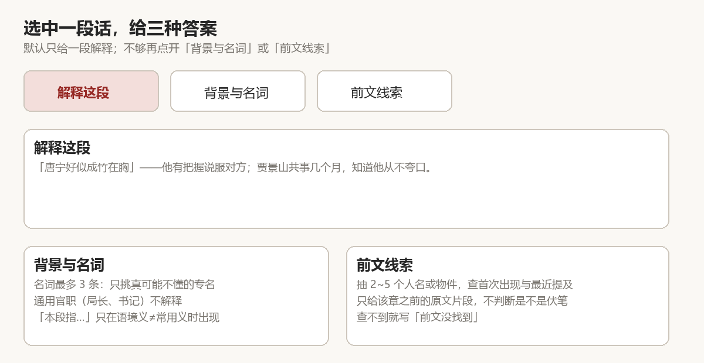

# 长篇小说 AI 阅读助手（方案说明）


**给读长篇网文的人：397 万字的书，AI 也记得住前文、答得准、不剧透。**


```bash
git clone https://github.com/yjnmedia/ai-reading-assistant.git
cd ai-reading-assistant && cat docs/02-演示脚本.md
```

## 它解决什么问题

长篇小说动辄百万字，主流大模型一次读不完：一本 397 万字的书约 290 万 token，是 256k 上下文窗口的 **11 倍**，换成 100 万 token 的模型也不够。所以这类需求不能靠「把书塞进去」，只能**先在本地把书拆开、建索引，再按问题取片段**。

## 三种答案，一句话起步



选中一段话，默认只给一段解释；不够再点开另外两页：

| 你要的 | 它给什么 | 边界 |
|---|---|---|
| 解释这段 | 一段话说明这段在讲什么 | 不做文学评论 |
| 背景与名词 | 时代背景 + 最多 3 个专名 | 通用官职不解释 |
| 前文线索 | 人名/物件首次出现与最近提及 | 只查当前章之前，不判断「是不是伏笔」 |

## 三个硬指标（都实测过）

- **不剧透**：客户端只上报「我在第几章 + 当前位置前 200 字」，服务端用 `ch_global < 当前章` 在 SQL 层硬截断。按章号查会越界（实测跨版本最多越界 92.2%），所以不用章号做主键。
- **认得出是同一本书**：4096 个 9-gram 指纹算相似度，≥0.90 判同书。实测同书异版 **0.9956**、不同书 **0.0000**。
- **花得起**：单本索引（889 章摘要 + 89 条聚合、978 次调用）批量价约 **5.4 元**，5 并发 25~30 分钟；单次问答约 **0.03 元**。

## 目录

- [01-技术方案](docs/01-技术方案.md)：整体结构、索引管线、成本模型、交付边界
- [02-演示脚本](docs/02-演示脚本.md)：10 分钟照做能复现的五步
- [03-技术问答](docs/03-技术问答.md)：为什么不用向量库、为什么不上传全书、许可与边界

## 边界

这里放的是**方案与实测数据**，不是可直接安装的软件，也不包含阅读器客户端源码。索引机与问答服务跑在自己家里，云端只做密文转发，书的内容不出家门。
